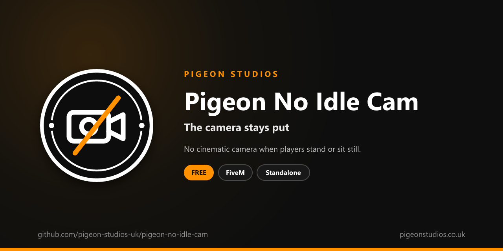

<div align="center">
  

  <h1>Pigeon No Idle Cam</h1>

  <p><strong>Stops GTA's cinematic idle camera from taking over when a player stands or sits still.</strong></p>

  <p>
    <a href="https://github.com/pigeon-studios-uk/pigeon-no-idle-cam/releases/latest"></a>
    <a href="LICENSE.md"></a>
    <a href="https://discord.gg/2NFVWEUmDF"></a>
    
  </p>

  <p>
    <a href="https://github.com/pigeon-studios-uk/pigeon-no-idle-cam/releases/latest"><strong>Download</strong></a> ·
    <a href="#installation">Install</a> ·
    <a href="#configuration">Configure</a> ·
    <a href="CHANGELOG.md">Changelog</a> ·
    <a href="https://discord.gg/2NFVWEUmDF">Support</a>
  </p>
</div>

---

## Contents

- [Overview](#overview)
- [Features](#features)
- [Requirements](#requirements)
- [Installation](#installation)
- [Updating](#updating)
- [Configuration](#configuration)
- [How it works](#how-it-works)
- [Update checker](#update-checker)
- [Performance](#performance)
- [Security](#security)
- [Troubleshooting](#troubleshooting)
- [FAQ](#faq)
- [Support](#support)
- [Contributing](#contributing)
- [Licence](#licence)
- [Credits](#credits)

## Overview

Pigeon No Idle Cam is a free resource by [Pigeon Studios](https://pigeonstudios.co.uk) that turns off GTA's idle camera. In GTA, if a player doesn't touch the controls for about 30 seconds, the camera drifts away from behind them into slow cinematic shots. On roleplay servers, where players often stand still talking, sit in a car at a scene or wait at a desk, it pulls them out of the scene and stops them seeing what's happening around them.

With this resource, the camera stays where the player left it, for as long as they stand or sit still.

## Features

- **No idle camera on foot.** Stand still as long as you like.
- **No idle camera in vehicles.** Sit in a parked car without the camera wandering off.
- **Choose where.** Keep either one if you want to.
- **Nothing else changes.** The camera modes players pick and the cinematic camera button work as normal.
- **Standalone.** No framework or other resources needed.

## Requirements

| Requirement | Version | Notes |
|---|---|---|
| FXServer | A [recommended artifact](https://runtime.fivem.net/artifacts/) | |

**Frameworks:** none needed. It works the same on standalone servers, ESX Legacy, QBCore, Qbox and ox_core.

## Installation

1. **Download** `pigeon-no-idle-cam.zip` from the [latest release](https://github.com/pigeon-studios-uk/pigeon-no-idle-cam/releases/latest). Don't use the green **Code** button; release zips are the tested builds.
2. **Extract** it into your server's `resources` folder. The folder must be called `pigeon-no-idle-cam`.
3. **Start it** by adding this to `server.cfg`:

   ```cfg
   ensure pigeon-no-idle-cam
   ```

4. **Configure** it in `configuration/config.lua` if you want to change anything. The defaults work as they are.
5. **Restart** your server. The console shows one line from the update checker:

   ```text
   [Pigeon Studios] Pigeon No Idle Cam v1.0.0 is up to date.
   ```

## Updating

1. Read the [changelog](CHANGELOG.md) for every version between yours and the latest, especially any **Upgrade notes**.
2. Back up your `configuration/` folder.
3. Replace the `pigeon-no-idle-cam` folder with the new release.
4. Copy your changed settings into the new `configuration/config.lua`. Don't copy the old file over the new one; new versions can add settings.
5. Restart the resource.

## Configuration

All settings are in `configuration/config.lua`, each explained by a comment next to it.

| Setting | Default | What it does |
|---|---|---|
| `Config.OnFoot` | `true` | Stop the idle camera on foot |
| `Config.InVehicles` | `true` | Stop the idle camera in vehicles |
| `Config.IntervalSeconds` | `1.0` | How often GTA's idle timers are reset. Anything under 25 works |

## How it works

GTA counts how long a player has gone without input, and starts the idle camera after about 30 seconds. It keeps one timer for players on foot and one for players in vehicles. Every `Config.IntervalSeconds`, the resource resets the timers you've chosen with `InvalidateIdleCam` and `InvalidateVehicleIdleCam`, so they never reach 30 seconds. The player's controls and camera aren't touched.

## Update checker

When it starts, Pigeon No Idle Cam checks our public [version registry](https://github.com/pigeon-studios-uk/pigeon-versions) once and prints one line in the server console saying whether it's up to date. If there's an update, it shows what's new and where to get it. The check is a single request to GitHub and sends nothing about your server or players.

Control it for every Pigeon Studios resource at once in `server.cfg`:

```cfg
set pigeon_update_check "on"      # default: one line per resource
set pigeon_update_check "quiet"   # only when there's an update or a problem
set pigeon_update_check "off"     # never check
```

## Performance

It resets two timers once a second and does nothing else. Nothing runs every frame, and nothing runs on the server apart from the update check at start-up.

## Security

- It runs only in each player's own game and only changes that player's own camera timers.
- It has no commands, exports or network events, so there is nothing other players, other resources or the server can send it.
- The only network request is the update check at start-up, from the server to GitHub. It sends nothing about your server or players.
- It's a camera setting, not a rule, so there's nothing for anyone to get around.

Found a problem? Please don't open a public issue. Use the **Report a vulnerability** button in this repository's **Security** tab, or follow our [Security Policy](https://github.com/pigeon-studios-uk/.github/blob/main/SECURITY.md).

## Troubleshooting

**The idle camera still starts.**
Check the resource is started (`ensure pigeon-no-idle-cam`) and there are no errors in the F8 console. If you've raised `Config.IntervalSeconds`, keep it under 25.

**The camera still moves when I press V.**
That's GTA's camera mode button, which this resource leaves alone.

**The console says "isn't in the version registry" or "couldn't check for updates".**
Your server couldn't reach GitHub, or the check is blocked by a firewall. The resource works normally either way. Turn the check off with `set pigeon_update_check "off"`.

## FAQ

**Is it really free?**
Yes. Use it on as many servers as you like, including ones that take donations. You just can't reupload, resell or bundle it. See [Licence](#licence).

**Does it stop AFK kicks?**
No. It only changes the camera. AFK resources check for input themselves.

**Does it affect the cinematic camera button in vehicles?**
No. Holding the cinematic camera button works as normal.

## Support

Read [Troubleshooting](#troubleshooting) first, then ask in the support channels of our [Discord](https://discord.gg/2NFVWEUmDF). Please include your Pigeon No Idle Cam version, FXServer artifact and any errors from the console. See [Getting help](https://github.com/pigeon-studios-uk/.github/blob/main/SUPPORT.md).

Found a bug? Open a [bug report](https://github.com/pigeon-studios-uk/pigeon-no-idle-cam/issues/new/choose).

## Contributing

Fixes, improvements and translations are welcome. Please read the [contributing guide](https://github.com/pigeon-studios-uk/.github/blob/main/CONTRIBUTING.md) first, and open a feature request before working on anything big.

## Licence

Pigeon No Idle Cam is free to use under the **[Pigeon Studios Free Licence](LICENSE.md)**.

- ✅ Use it on any number of servers, including monetised ones
- ✅ Change it for your own servers
- ✅ Show it in videos and streams
- ❌ Don't reupload, share or mirror the files; link to this repository instead
- ❌ Don't sell it, bundle it in packs, or put it behind escrow
- ❌ Don't remove the credits

This summary isn't the licence; [LICENSE.md](LICENSE.md) is. Third-party notices are in [NOTICE.md](NOTICE.md).

## Credits

Made by [Pigeon Studios](https://pigeonstudios.co.uk).

<sub>Not affiliated with or endorsed by Rockstar Games, Take-Two Interactive or Cfx.re.</sub>
